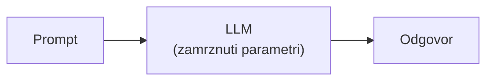
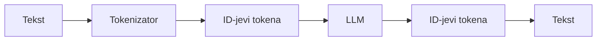
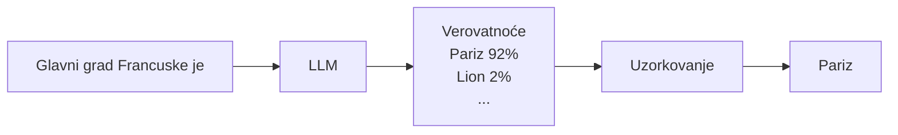
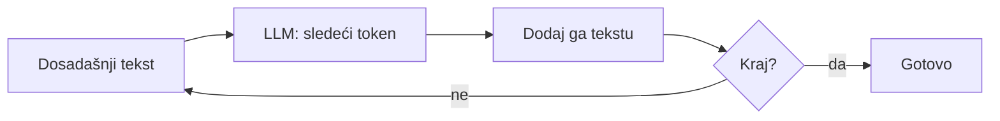

# Kako rade LLM-ovi

> Sekcija 1 od [materijala za seminar](../README.md)

## 1. LLM je funkcija tekst → tekst

- Osnovna veština: **predvideti sledeći deo teksta**
- Parametri (težine) su fiksni, model **ne uči** iz naših promptova
- Mi ga samo pokrećemo (**inferencija**), trening nije tema

## 2. Tekst se sastoji od tokena

- **Token** = deo teksta (reč, deo reči, interpunkcija)
- Model vidi cele brojeve (ID-jeve), a ne slova
- Ograničenja i cena se računaju u **tokenima**
- Okvirno: 1 token ≈ 0,75 engleskih reči

## 3. Jedan korak predviđa jedan token

- Model daje **verovatnoću za svaki token**
- **Uzorkovanje** (sampling) bira jedan token; **temperatura** kontroliše slučajnost
  - Niska → predvidljivo. Visoka → raznovrsno
- Isti prompt može dati različite odgovore

## 4. Dug izlaz = petlja

- Novi token se **dodaje na ulaz**, pa se model pokreće ponovo
- Staje kada naiđe **token za kraj teksta** ili kada se dostigne **maksimalan broj tokena**

## 5. Kontekst = sve što model vidi

- **Kontekst** = prompt + dosad generisani tokeni
- **Kontekstni prozor** = najveći broj tokena koje model može da drži (ulaz + izlaz)
- Model ne koristi ništa drugo
- Svaki poziv je **nezavisan**: ništa se ne pamti između poziva

## Zaključci

- LLM = zamrznuti prediktor sledećeg tokena
- Izlaz se gradi token po token, svaki novi token vraća se na ulaz
- Vidi samo svoj kontekst i ništa ne pamti između poziva

---

Sledeće: [Kako se pravi chatbot](02-chatbot.md)
