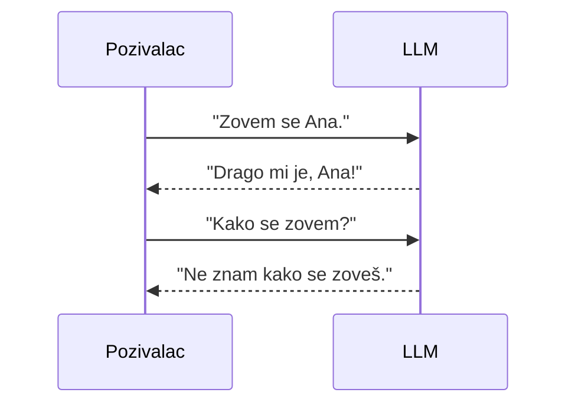
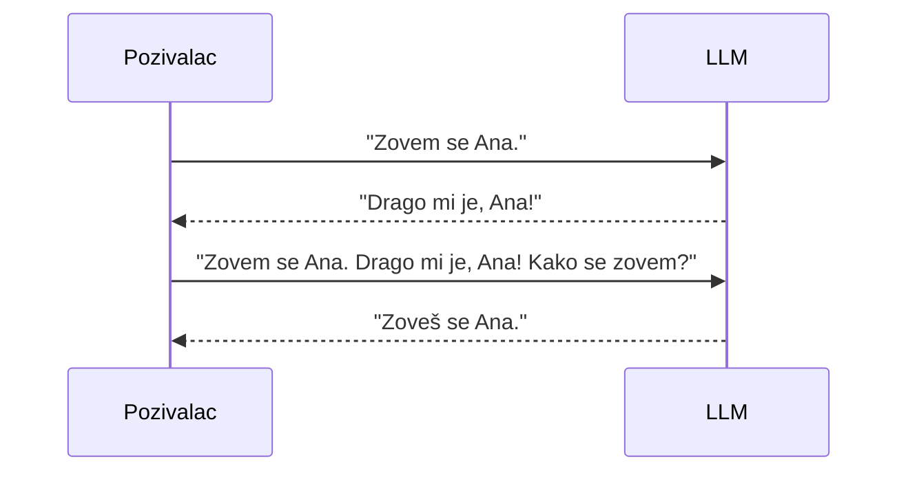
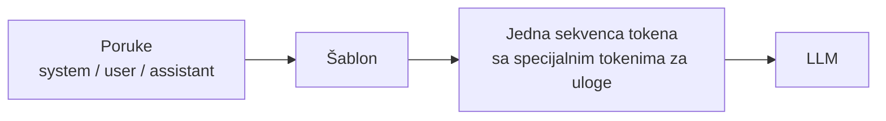
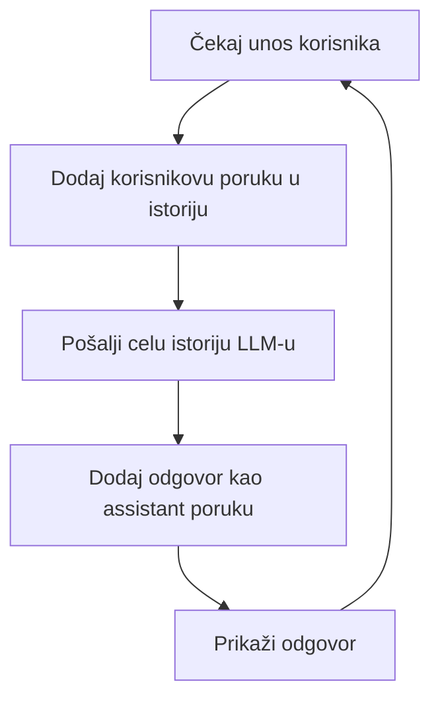

# Kako se pravi chatbot

> Sekcija 2 od [materijala za seminar](../README.md)

## 1. Problem: model nema memoriju



- Svaki poziv je **bez stanja** (stateless)

## 2. Rešenje: ponovo pošalji istoriju



- **Pozivalac** čuva istoriju, ne model
- Svaki poziv šalje **ceo razgovor** iznova

## 3. Poruke i uloge



```text
<|system|> Odgovaraj jednom rečenicom.
<|user|> Koji je glavni grad Francuske?
<|assistant|>
```

- Istorija = **lista poruka**, svaka ima ulogu
- Uloge su označene **specijalnim tokenima** u jednoj ravnoj sekvenci
- Model samo **nastavlja tekst** posle `<|assistant|>`
- `system` poruka = uputstvo koje određuje ponašanje

## 4. Petlja razgovora



```python
history = [{"role": "system", "content": "Ti si koristan asistent."}]
while True:
    history.append({"role": "user", "content": input("> ")})
    reply = llm(history)
    history.append({"role": "assistant", "content": reply})
    print(reply)
```

- Chatbot = **petlja + lista** oko LLM-a bez stanja

## 5. Istorija raste

- Svaki krug čini sledeći poziv većim → **sporije i skuplje**
- Prozor pun? Izbaci najstarije poruke ili ih sažmi

## Zaključci

- „Razgovor“ živi kod pozivaoca, a ne u modelu
- Chatbot = čuvaj listu poruka, pošalji je celu, dodaj odgovor, ponovi

---

Prethodno: [Kako rade LLM-ovi](01-how-llms-work.md) · Sledeće: [Šta radi harness](03-harness.md)
