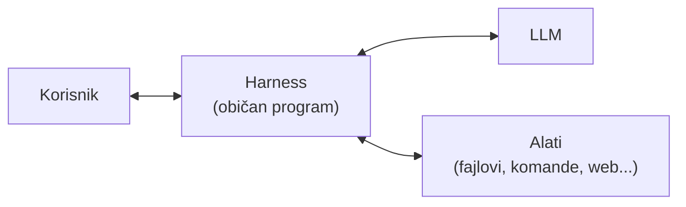
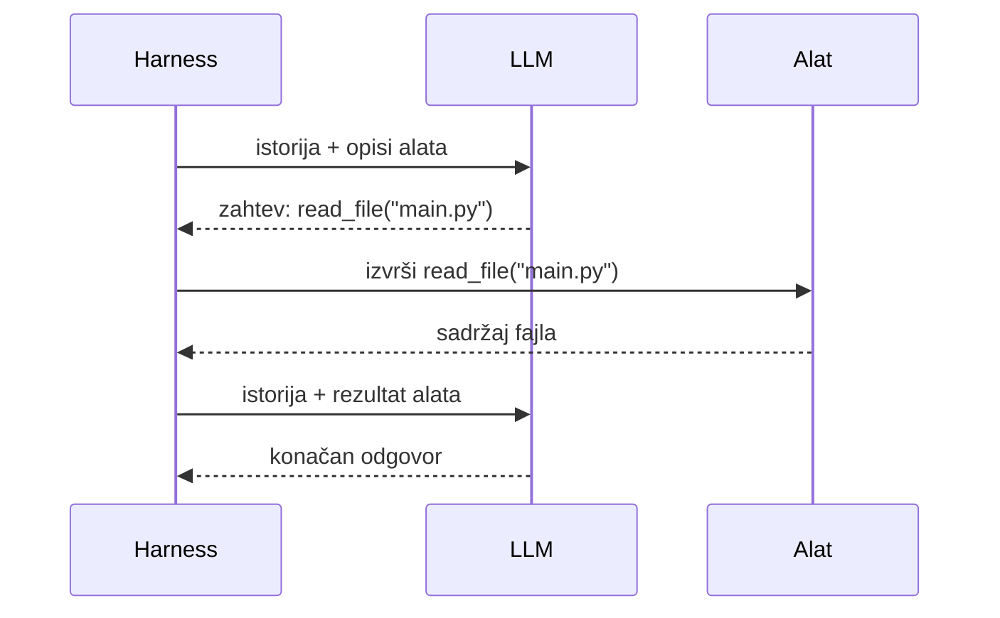
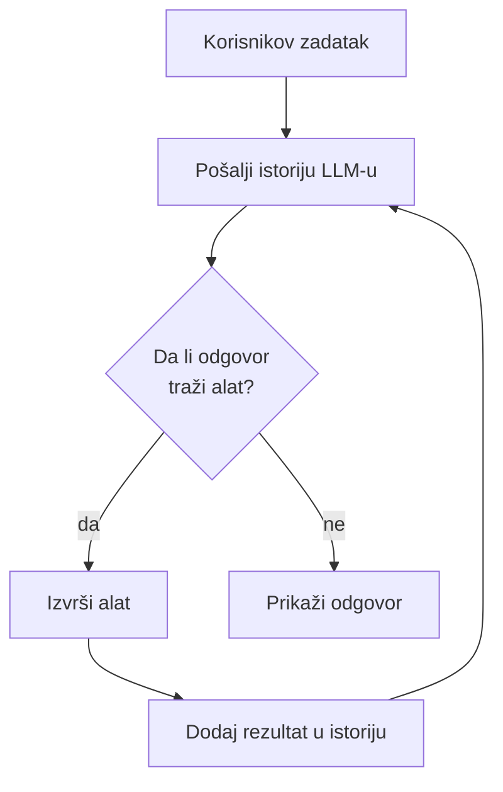
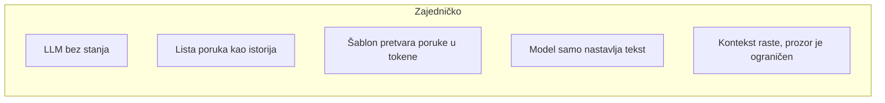

# Šta radi harness

> Sekcija 3 od [materijala za seminar](../README.md)

## 1. Šta je harness



- **Harness** = program oko LLM-a koji vodi ceo proces
- LLM i dalje samo **predviđa tekst**, bez stanja
- Sve ostalo — istoriju, alate, petlju, bezbednost — radi harness
- Chatbot iz prethodne sekcije je **najjednostavniji harness**

## 2. Šta harness radi

- Čuva **istoriju** poruka
- Sastavlja **prompt**: uputstva + opisi alata + istorija
- Poziva LLM
- **Izvršava alate** koje model zatraži
- Vraća rezultate modelu
- Odlučuje **kada je gotovo**
- Pazi na **kontekst** i **dozvole**

## 3. Kako model „koristi“ alat

- Model **ne izvršava ništa**, on samo **piše tekst**
- Taj tekst ima dogovoren format: „želim da pozovem alat X sa ovim argumentima“
- Harness **prepozna** zahtev, izvrši alat i rezultat doda u istoriju



Primer zahteva (jednostavan JSON, tekst koji model generiše):

```json
{ "tool": "read_file", "arguments": { "path": "main.py" } }
```

- Opis alata (ime, šta radi, argumenti) je **deo konteksta**
- Rezultat alata je nova poruka u istoriji (uloga `tool`)

## 4. Petlja harnessa



```python
history = [system_prompt, user_task]
while True:
    reply = llm(history, tools=TOOLS)
    history.append(reply)
    if not reply.tool_calls:
        break                      # model je odgovorio, kraj
    for call in reply.tool_calls:
        result = run_tool(call)    # izvršava harness, ne model
        history.append({"role": "tool", "content": result})
```

- Za **jedan** zadatak korisnika, LLM se poziva **više puta**
- Petlja staje kada model odgovori **bez** zahteva za alat

## 5. Chatbot vs harness

| | Chatbot | Harness |
|---|---|---|
| Ko pokreće sledeći poziv LLM-a | Korisnik (novom porukom) | Sam harness, posle svakog alata |
| Poziva LLM po korisnikovoj poruci | 1 | Mnogo |
| Šta model može | Samo da piše tekst | Da **zatraži** akcije |
| Ko izvršava akcije | Niko | Harness |
| Uloge u istoriji | system, user, assistant | + `tool` |
| Prompt | Kratko uputstvo | Uputstva + opisi alata + kontekst projekta |
| Kraj | Posle jednog odgovora | Kada model više ne traži alat |
| Dozvole | Nepotrebne | Potrebne (šta sme da se izvrši) |
| Upravljanje kontekstom | Opcionalno | Obavezno (rezultati alata brzo puna prozor) |

## 6. Šta je isto



- Model je **isti** — predviđa sledeći token
- Istoriju čuva **pozivalac**, a ne model
- Sve se šalje kao **jedna sekvenca tokena**
- Odgovor se **dodaje u istoriju**, pa se ponavlja
- Kontekst je i dalje **jedino** što model vidi

## 7. Šta je drugačije

- **Dve petlje** umesto jedne:
  - spoljna: korisnik → odgovor
  - unutrašnja: model → alat → model → alat ...
- Model dobija **dejstvo na svet**, ali samo preko harnessa
- **Rezultati alata** postaju kontekst (mogu biti veliki)
- Harness mora da **štiti**: traži odobrenje, ograničava šta sme
- Kontekst se mora **aktivno održavati**: sažimanje, brisanje starih rezultata

## Zaključci

- Harness = chatbot petlja + alati
- Model i dalje samo piše tekst; **harness radi sve ostalo**
- Ista osnova (kontekst, istorija, petlja), samo sa **unutrašnjom petljom** za alate

---

Prethodno: [Kako se pravi chatbot](02-chatbot.md) · Sledeće: [Halucinacije](04-hallucinations.md)
