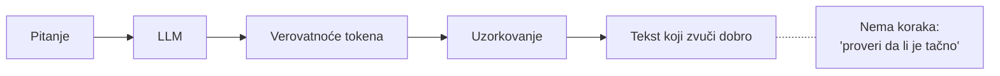
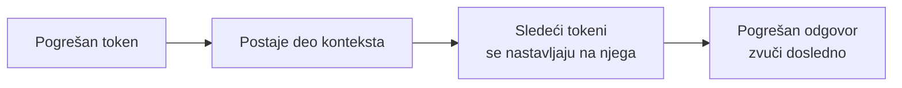
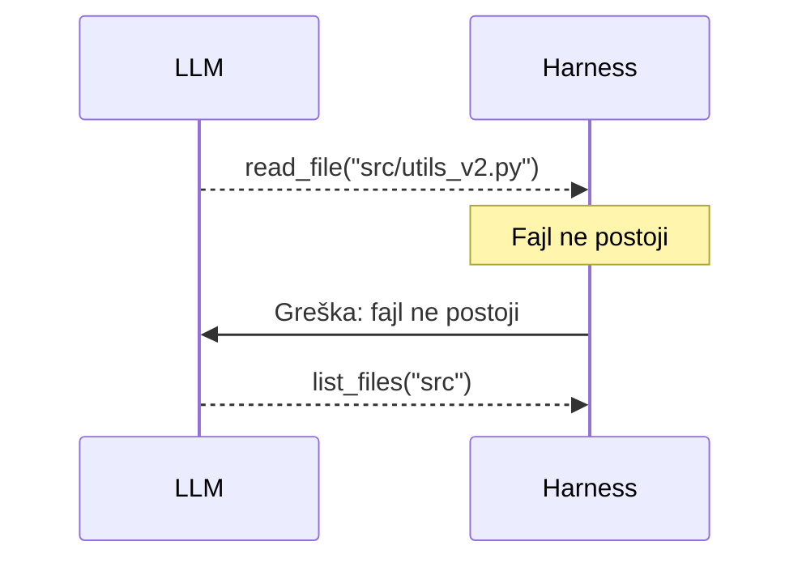

# Halucinacije

> Sekcija 4 od [materijala za seminar](../README.md)

## 1. Šta je halucinacija

- Model proizvodi tekst koji **zvuči ubedljivo, a nije tačan**
- Izmišljene činjenice, citati, imena, brojevi, linkovi, funkcije
- Zvuči **sigurno** — ton ne govori ništa o tačnosti

Primer:

| Pitanje | Odgovor modela |
|---|---|
| „Navedi rad o temi X sa autorima i linkom.“ | Realno izgledajući naslov, autori i URL koji **ne postoje** |

## 2. Zašto se dešava

Podsetnik iz [sekcije 1](01-how-llms-work.md): model **predviđa verovatan tekst**, ne proverava istinu.

- **Cilj** modela je verovatan nastavak, a ne istinit
- Nema baze činjenica ni provere — samo **parametri** koji su ostali posle treninga
- Model **uvek mora da izabere token**; „ne znam“ je samo jedan od mogućih odgovora
- Znanje je **zamrznuto** — ne zna šta se desilo posle treninga
- Vidi samo **kontekst** — ono što mu nismo dali, ne zna

## 3. Greška se vraća na ulaz

- Generisanje je **token po token** ([sekcija 1](01-how-llms-work.md))
- Model ne ide unazad: izabrani token ostaje i **utiče na ostatak odgovora**

## 4. Kada je češće

- **Retke činjenice** (malo viđene u podacima)
- **Tačni detalji**: brojevi, datumi, citati, URL-ovi, verzije
- Pitanja sa **pogrešnom pretpostavkom** („Kada je Pariz postao glavni grad Nemačke?“)
- **Nedostaje kontekst**, a pitanje zahteva konkretan izvor
- Veoma **dug izlaz**

## 5. Halucinacije u harnessu

Podsetnik iz [sekcije 3](03-harness.md): model piše zahteve za alate kao tekst, pa i tu može da izmišlja.

- Mogu se izmisliti **fajlovi, funkcije, argumenti, čak i alati**
- Harness **proverava** zahtev i greška se vraća modelu kao rezultat alata
- Model može da **ispravi kurs** — zato su stvarni rezultati alata dragoceni
- Ali harness ne ume da otkrije **pogrešan zaključak** koji izgleda razumno

## Zaključci

- Halucinacija = verovatan, ali netačan tekst, i to je **posledica načina rada**, ne kvar
- Model optimizuje verovatnoću, ne istinu
- Ne veruj izlazu samo zato što zvuči sigurno

---

Prethodno: [Šta radi harness](03-harness.md) · Sledeće: [Šta je agent](05-agent.md)
