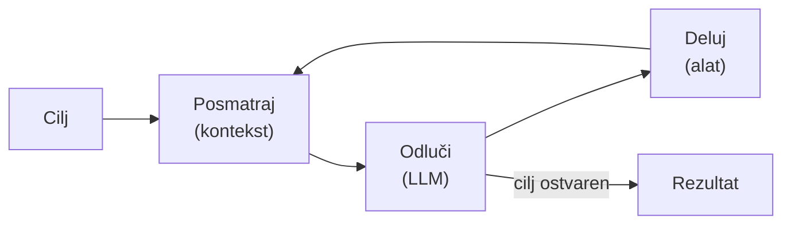
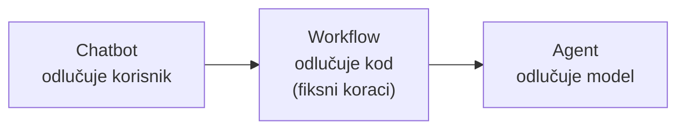

# Šta je agent

> Sekcija 5 od [materijala za seminar](../README.md)

## 1. Definicija

- **Agent** = LLM koji u petlji **sam bira sledeći korak** (alat) da bi ostvario **cilj**
- Korisnik daje **cilj**, ne pojedinačno pitanje
- Agent je ceo sistem: **model + harness + alati**

## 2. Spektar: chatbot → workflow → agent

| | Chatbot | Workflow | Agent |
|---|---|---|---|
| Ko bira sledeći korak | Korisnik | Programer, unapred | Model, tokom rada |
| Broj koraka | 1 | Poznat | Nepoznat |
| Predvidljivost | Visoka | Visoka | Niža |
| Cena i trajanje | Mala | Srednja | Veća |

- Koraci poznati unapred → **workflow** (jeftinije, predvidljivije)
- Koraci zavise od onoga što se usput otkrije → **agent**

## 3. Agent i harness

- **Harness** = softver oko modela ([sekcija 3](03-harness.md))
- **Agent** = harness koji sa modelom radi na cilju
- Model sam ne može ništa da uradi, sve radnje izvršava harness

## 4. Alati: osnovni principi

- Alat = **ime + opis + argumenti** (šema)
- Model bira alat **samo na osnovu opisa** — opis je deo prompta
- Model **traži**, harness **izvršava**, rezultat se vraća kao **tekst u kontekst**
- Greška je takođe rezultat: model je vidi i može da proba drugačije
- Malo jasnih alata radi bolje od mnogo sličnih
- Tipični alati: čitanje i izmena fajlova, pretraga, pokretanje komandi, web

## Zaključci

- Agent = LLM + alati + petlja, ka cilju
- Razlika od chatbota i workflowa: **model odlučuje o sledećem koraku**
- Više slobode = manje predvidljivosti i veća cena

---

Prethodno: [Halucinacije](04-hallucinations.md) · Sledeće: [Uputstva i prompt](06-instructions.md)
