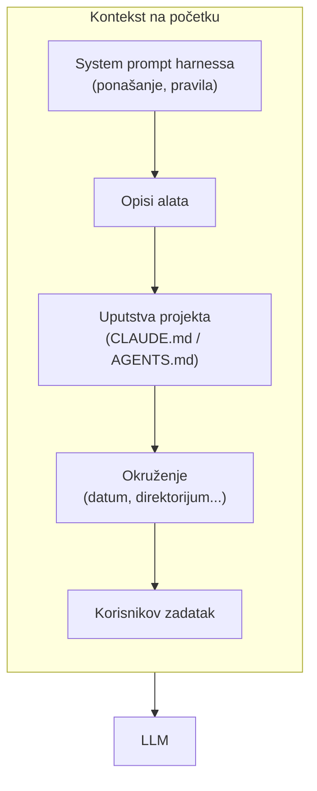

# Uputstva i sastavljanje prompta

> Sekcija 6 od [materijala za seminar](../README.md)

## 1. Šta model vidi pre prve korisnikove reči



- **Harness sastavlja prompt**, korisnik vidi samo svoj deo
- Model nema memoriju ([sekcija 2](02-chatbot.md)), pa se sve ovo šalje **iznova** u svakom pozivu

## 2. Fajl sa uputstvima projekta

- Običan **markdown fajl** u projektu (npr. `CLAUDE.md`, `AGENTS.md`)
- Harness ga **učita u kontekst na početku svake sesije**
- Zamenjuje ono što model ne može da zapamti između sesija

Šta ide unutra:

- Komande za build, test, pokretanje
- Struktura projekta i konvencije
- Stvari koje se ne vide iz koda (zašto, ne šta)

```markdown
# Projekat
- Build: `pnpm build`, testovi: `pnpm test`
- Backend je u `server/`, frontend u `web/`
- Ne menjaj generisane fajlove u `gen/`
```

## 3. Slojevi uputstava

| Sloj | Primer | Važi za |
|---|---|---|
| Korisnik | lični fajl u home folderu | Svi projekti |
| Projekat | fajl u korenu repozitorijuma | Taj projekat, ceo tim |
| Folder | fajl u podfolderu | Samo taj deo |

## 4. Principi

- Ono što **nije u kontekstu, model ne zna**
- Svaki red košta **tokene** u svakom pozivu → piši kratko
- Previše uputstava = **važna se zagube**
- Konkretno ("koristi `pnpm`") radi bolje od opšteg ("piši dobar kod")
- Uputstvo je **savet** koji model obično, ali ne garantovano, poštuje

## Zaključci

- Prompt koji model vidi je **mnogo veći** od onoga što korisnik napiše
- Fajl sa uputstvima = trajno "pamćenje" projekta, učitano iznova svaki put
- Kratka, konkretna uputstva

---

Prethodno: [Šta je agent](05-agent.md) · Sledeće: [Upravljanje kontekstom](07-context-management.md)
