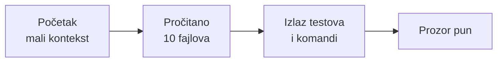
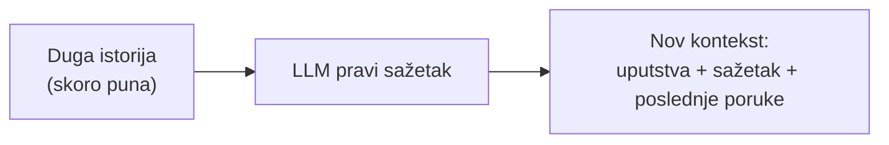

# Upravljanje kontekstom

> Sekcija 7 od [materijala za seminar](../README.md)

## 1. Problem: rezultati alata pune prozor

- Svaki rezultat alata (fajl, izlaz komande, pretraga) **ulazi u kontekst**
- Kontekst se šalje u **svakom** pozivu ([sekcija 2](02-chatbot.md)) → sve sporije i skuplje
- Više konteksta ≠ bolje: **važni detalji se mogu zagubiti** u gomili teksta

## 2. Tehnike

| Tehnika | Ideja |
|---|---|
| Manji rezultati | Pretraži umesto da pročitaš sve; čitaj deo fajla; skrati izlaz |
| Brisanje starog | Ukloni stare rezultate alata koji više nisu potrebni |
| Kompakcija | Sažmi dosadašnji razgovor i nastavi sa sažetkom |
| Spoljna memorija | Upiši bitno u fajl (plan, beleške) i čitaj po potrebi |
| Subagenti | Težak posao u zasebnom kontekstu ([sekcija 11](11-subagents.md)) |

## 3. Kompakcija

- Harness to radi **automatski** kad se prozor popuni, ili na zahtev korisnika
- Sažetak **gubi detalje** → ono što mora da preživi, upiši u fajl ili uputstva
- Nakon kompakcije model zna samo ono što je u sažetku

## 4. Keširanje prompta

- Početak konteksta je **isti** u svakom pozivu (uputstva, alati, stara istorija)
- Provajder može da **ponovo iskoristi obračun** za nepromenjeni početak → jeftinije i brže
- Zato harness **dodaje na kraj**, a ne menja početak
- Izmena na početku konteksta poništava keš

## Zaključci

- Kontekst je **ograničen i skup** resurs, agent ga troši brzo
- Cilj: u kontekstu da bude **samo ono što treba**
- Skraćuj, briši, sažimaj, ili izmesti u fajl

---

Prethodno: [Uputstva i prompt](06-instructions.md) · Sledeće: [Provera i povratne sprege](08-verification.md)
