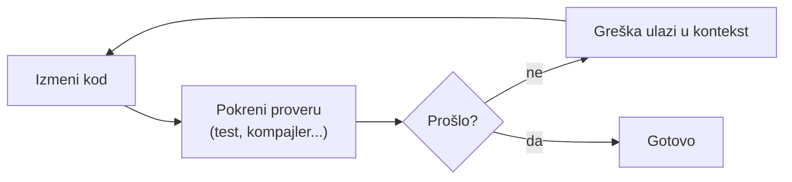

# Provera i povratne sprege

> Sekcija 8 od [materijala za seminar](../README.md)

## 1. Zašto agentu treba provera

- Model može da **halucinira** ([sekcija 4](04-hallucinations.md)) i da ne primeti
- Agent koji ne može da proveri rad samo **pretpostavlja** da je tačan
- Stvaran rezultat (greška kompajlera, pad testa) je **činjenica u kontekstu**, a ne nagađanje

## 2. Povratna sprega

- Rezultat provere se vraća modelu kao **rezultat alata**
- Petlja traje dok se provera ne zadovolji

## 3. Vrste provere

| Provera | Šta otkriva |
|---|---|
| Kompajler, tipovi | Sintaksu i neslaganje tipova |
| Linter, formater | Stil i česte greške |
| Testovi | Da li kod radi ono što treba |
| Pokretanje programa | Stvarno ponašanje |
| Browser, snimak ekrana | Izgled i tok u interfejsu |
| Pregled čoveka | Ono što automatika ne vidi |

## 4. Principi

- Daj agentu **način da proveri** sopstveni rad
- Definiši "gotovo" **merljivo**: "svi testovi prolaze", a ne "lepo izgleda"
- Brza provera (sekunde) = više iteracija
- Agent može da **zaobiđe proveru** (menja test umesto koda) → pregledaj šta je izmenio
- Prošla provera ≠ tačno rešenje; proveravaju se samo ona svojstva koja test pokriva

## Zaključci

- Provera pretvara nagađanje u **informaciju**
- Povratna sprega = petlja izmena → provera → ispravka
- Čovek i dalje pregleda ono što je važno

---

Prethodno: [Upravljanje kontekstom](07-context-management.md) · Sledeće: [Planiranje i razmišljanje](09-planning.md)
