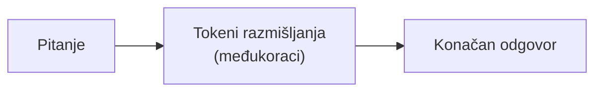
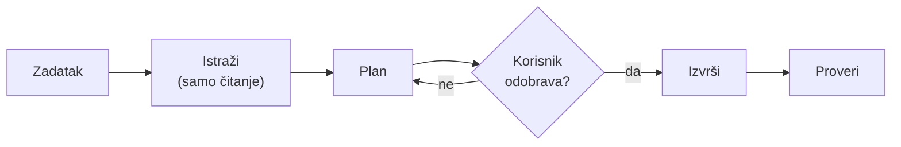

# Planiranje i razmišljanje

> Sekcija 9 od [materijala za seminar](../README.md)

## 1. Razmišljanje (reasoning)

- Model **prvo piše međukorake**, pa tek onda odgovor
- Podsetnik ([sekcija 1](01-how-llms-work.md)): jedan prolaz = **jedan token**
- Više tokena pre odgovora = **više koraka računanja** i prostora za ispravku
- Međukoraci su deo konteksta, pa utiču na ostatak odgovora
- Košta **tokene i vreme**

## 2. Planiranje

- Pre izvršavanja, agent **napiše plan**: koraci, fajlovi, redosled
- Plan je tekst u kontekstu, pa ga model prati dok radi
- **Lista zadataka** (todo) = plan koji se ažurira i štiti od zaborava
- Plan se može sačuvati u fajl, pa preživi kompakciju ([sekcija 7](07-context-management.md))

## 3. Tok: istraži → planiraj → izvrši

- **Režim planiranja** (plan mode): agent samo čita i predlaže, ne menja ništa
- Ispraviti plan je **jeftino**, ispraviti pogrešan kod je skupo
- Dobro za složene zadatke; za sitne izmene je suvišno

## 4. Ograničenja

- Plan može biti **pogrešan**, a zvučati sigurno
- Razmišljanje ne garantuje tačnost
- Više razmišljanja = sporije i skuplje
- Jednostavni zadaci ne trebaju plan

## Zaključci

- Razmišljanje i plan su **tekst koji model sam piše** i zatim koristi kao kontekst
- Planiraj složeno, preskoči jednostavno
- Odobri plan pre izvršavanja

---

Prethodno: [Provera i povratne sprege](08-verification.md) · Sledeće: [Dozvole i bezbednost](10-safety.md)
