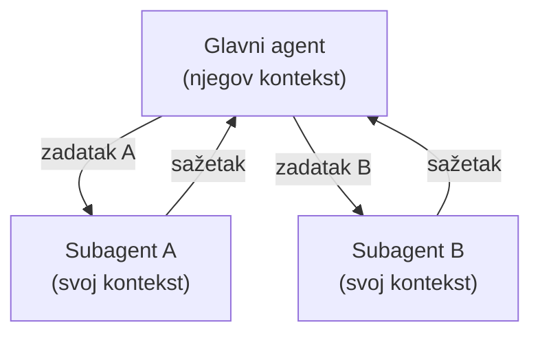

# Subagenti

> Sekcija 11 od [materijala za seminar](../README.md)

## 1. Šta je subagent

- **Subagent** = drugi agent koga glavni agent pokrene za **jedan zadatak**
- Ima **svoj kontekst** i svoju petlju
- Glavnom agentu vraća samo **kratak rezultat** (sažetak)

- Za glavnog agenta, pokretanje subagenta je **samo još jedan alat**

## 2. Zašto

- **Izolacija konteksta**: bučan posao (pretraga, čitanje mnogo fajlova) ne puni glavni prozor ([sekcija 7](07-context-management.md))
- **Paralelizam**: nezavisni zadaci istovremeno
- **Specijalizacija**: drugačija uputstva, drugi alati, ponekad jeftiniji model

## 3. Cena

- Ukupno se troši **više tokena**
- Subagent **ne vidi razgovor** → zadatak mora da sadrži sav potreban kontekst
- Sažetak **gubi detalje**
- Teže je pratiti šta se dešava

## 4. Kada koristiti

| Dobro | Loše |
|---|---|
| Istraživanje i pretraga koda | Koraci koji su usko povezani |
| Nezavisni delovi posla | Mala, brza izmena |
| Pregled koda u svežem kontekstu | Kada su potrebni svi detalji u glavnom kontekstu |

- **Multi-agent** sistem = više agenata koji sarađuju, princip je isti: svaki ima svoj kontekst, razmenjuju se samo poruke

## Zaključci

- Subagent = poseban kontekst za poseban zadatak
- Štedi glavni kontekst, ali košta tokene i gubi detalje
- Dobar zadatak za subagenta je jasan, odvojen i sa sažetim rezultatom

---

Prethodno: [Dozvole i bezbednost](10-safety.md) · Sledeće: [Proširivanje harnessa](12-extensibility.md)
