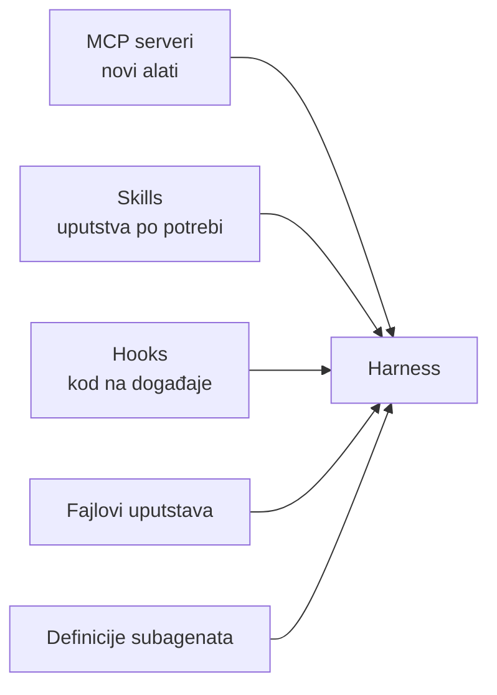

# Proširivanje harnessa

> Sekcija 12 od [materijala za seminar](../README.md)

## 1. Dodavanje mogućnosti bez menjanja harnessa

## 2. MCP (Model Context Protocol)

- **Standardni protokol** za priključivanje alata i izvora podataka
- MCP **server** nudi alate (npr. baza, kalendar, issue tracker)
- Harness njihove **opise doda u prompt**, kao i svoje alate
- Svaki alat troši **kontekst** (opis) → ne dodaj ih previše

## 3. Skills

- **Folder sa uputstvom** (i opciono skriptama) za određeni zadatak
- U kontekstu su samo **ime i kratak opis**
- **Ceo sadržaj se učitava tek kad zatreba** → štedi kontekst
- Model odlučuje kad ga koristi, na osnovu opisa

## 4. Hooks

- **Običan kod** koji harness pokreće na događaje (npr. pre ili posle poziva alata)
- Primer: posle svake izmene fajla pokreni formater
- Izvršava se **uvek**, ne zavisi od toga da li će model "zapamtiti"

## 5. Poređenje

| Mehanizam | Šta daje | Ko odlučuje kad se koristi |
|---|---|---|
| Fajl uputstava | Znanje, pravila | Učitava se uvek |
| MCP | Nove alate | Model |
| Skill | Uputstva za zadatak | Model, po opisu |
| Hook | Garantovanu akciju | Harness, na događaj |
| Subagent | Odvojen kontekst | Model |

- Treba **garancija**? → hook ili dozvole. Treba **savet**? → uputstvo

## 6. Oprez

- MCP serveri i skills su **tuđi kod i tekst** koji ulazi u kontekst ili se izvršava
- Primenjuje se sve iz [bezbednosti](10-safety.md): veruj samo izvorima kojima veruješ

## Zaključci

- Harness se proširuje alatima, uputstvima i kodom
- Biraj mehanizam prema tome da li ti treba **savet ili garancija**
- Svako proširenje košta kontekst i proširuje površinu napada

---

Prethodno: [Subagenti](11-subagents.md)
